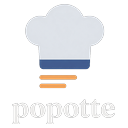

<p align="center">
  
</p>

# popotte

Application self-hostée de gestion de recettes et de génération de liste de courses,
pour un usage mono-foyer sur le réseau local.

On catalogue ses recettes, on en sélectionne plusieurs avec le nombre de portions
voulu, et l'application produit une liste de courses agrégée : les mêmes ingrédients
sont additionnés, les unités compatibles converties (g/kg, ml/cl/l), et le résultat
est trié par rayon de magasin.

## Fonctionnalités

- **Recettes** : titre, portions, durée, tags, photo, ingrédients quantifiés, étapes
- **Référentiel d'ingrédients partagé** : « Œufs », « oeuf » et « ŒUF » désignent le même ingrédient
- **Liste de courses agrégée** : somme par ingrédient, conversion d'unités, arrondi à
  une quantité d'achat réaliste (jamais 3,5 œufs), tri par rayon
- **Unités incompatibles jamais fusionnées** : « 1 pincée » + « 5 g » donne deux lignes
  distinctes signalées « à vérifier »
- **Coche des articles** persistée, pensée pour le supermarché (mobile, gros tap-targets)
- **Mode cuisine** : plein écran, une étape à la fois, lisible depuis l'autre bout du plan de travail

## Stack

Un seul langage, un seul conteneur, un seul fichier de base de données.

| Couche | Choix |
|---|---|
| Backend | Python 3.13 + Flask |
| Rendu | Jinja2 côté serveur + HTMX (aucun JS custom, aucun bundler) |
| Style | daisyUI / Tailwind auto-hébergés + `app/static/css/popotte.css` |
| Données | SQLite (fichier unique) + SQLAlchemy 2.0 |
| Auth | aucune — l'application n'est exposée que sur le réseau local |

> daisyUI, Tailwind, HTMX et les polices (Fraunces, Work Sans) sont servis par
> l'application elle-même depuis `app/static/vendor/` : **aucun appel réseau externe**,
> l'application fonctionne sur un réseau local sans accès Internet. Versions, licences et
> procédure de mise à jour dans [app/static/vendor/README.md](app/static/vendor/README.md).

## Démarrage en local

```bash
python3 -m venv .venv
.venv/bin/pip install -r requirements-dev.txt
.venv/bin/python wsgi.py
```

L'application écoute sur http://127.0.0.1:8000. Au premier lancement, la base est créée
et pré-remplie avec un référentiel d'ingrédients courants et trois recettes d'exemple.

## Déploiement Docker

```bash
docker compose up -d --build
```

Un seul service, exposé sur le port 8000, avec un volume `popotte-data` monté sur `/data`
(base SQLite + photos). À raccorder ensuite dans Nginx Proxy Manager vers
`recettes.lehavre.igny`.

### Configuration

La configuration passe par des variables d'environnement, toutes optionnelles. Pour les
personnaliser en déploiement, copier le modèle fourni :

```bash
cp .env.example .env
```

Compose lit ce fichier s'il existe et l'injecte dans le conteneur ; sans lui, les valeurs
par défaut s'appliquent. Le `.env` n'est pas versionné (il peut contenir la clé de session),
contrairement à `.env.example` qui documente les variables disponibles.

| Variable | Défaut | Rôle |
|---|---|---|
| `TZ` | `Europe/Paris` | fuseau du conteneur, utilisé pour dater les listes |
| `POPOTTE_DATA_DIR` | `/data` (Docker), `./data` (local) | base SQLite, photos, clé de session |
| `POPOTTE_SEED_DEMO` | `1` | `0` pour démarrer sans les recettes d'exemple |
| `POPOTTE_SECRET_KEY` | générée et persistée | clé de session (mémorise le panier en cours) |
| `POPOTTE_DATABASE_URL` | `sqlite:///$POPOTTE_DATA_DIR/popotte.db` | URL SQLAlchemy |
| `POPOTTE_DEBUG` | — | `1` pour le rechargement automatique en développement |
| `PORT` / `HOST` | `8000` / `127.0.0.1` | serveur de développement uniquement |

En développement local, le `.env` n'est pas lu automatiquement (pas de dépendance
`python-dotenv`) : préfixer la commande suffit, par exemple
`POPOTTE_DEBUG=1 .venv/bin/python wsgi.py`.

### Sauvegarde et mise à jour

- **Sauvegarde** : copier le contenu du volume `/data` (`popotte.db` et `uploads/`).
- **Mise à jour** : `docker compose up -d --build`. Le schéma manquant est créé au démarrage.

## Tests

```bash
.venv/bin/python -m pytest tests -q
```

Les tests couvrent la logique métier centrale (conversion d'unités, agrégation,
arrondis, unités incompatibles) et les parcours principaux de l'application.

## Organisation du code

```
app/
├─ models.py      modèle de données (recettes, ingrédients, listes)
├─ units.py       unités, alias, conversions, arrondis d'achat
├─ shopping.py    algorithme d'agrégation de la liste de courses
├─ seed.py        référentiel d'ingrédients + recettes d'exemple
├─ photos.py      upload et redimensionnement des photos
├─ views/         routes Flask (recettes, panier/liste, ingrédients)
├─ templates/     pages Jinja2 et fragments HTMX (préfixés par `_`)
└─ static/
   ├─ css/        charte graphique
   └─ vendor/     daisyUI, Tailwind, HTMX, polices (auto-hébergés)
```

Les dépendances front sont mises à jour par `./scripts/update-vendor.sh` (versions
épinglées en tête du script).

Les conventions de développement (stack imposée, périmètre, ce qui est refusé) sont
décrites dans [CLAUDE.md](CLAUDE.md) ; la conception dans
[conception-app-popotte.md](conception-app-popotte.md) et la charte graphique dans
[design-UI.md](design-UI.md).
